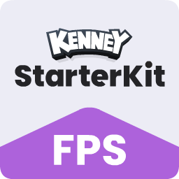
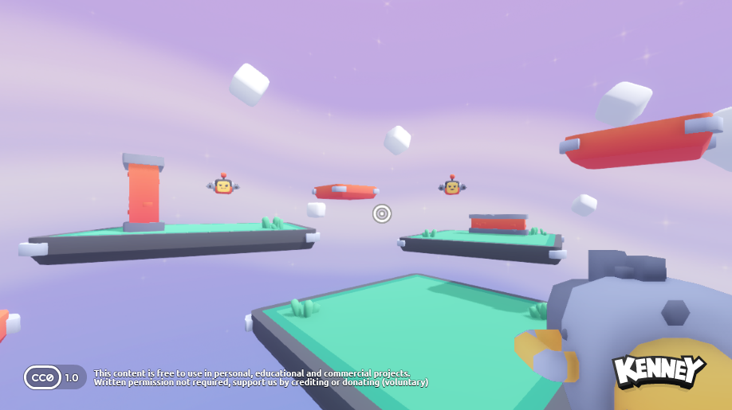

# Starter Kit FPS

This package includes a basic template for a first person shooter in Godot 4.6. Includes features like;

- Character controller
- Weapons, switching weapons
- Enemies
  - Flying drones that hover and shoot
  - Bombers: walking bomb robots that charge at you, hop across gaps and explode when close (shoot them from a distance!)
- Two levels, picked on the start screen: Easy (fewer enemies that hit softer) and Hard (every enemy, and they hit harder). Tune them in `scripts/difficulty.gd`
- Score: points for every enemy (drone 100, bomber 150, turret 200, golden drone 1000), combo multiplier up to x5 for quick kills in a row, a time bonus for winning under 10 minutes, and your best score and time are saved for each level
- Sprites and 3D Models _(CC0 licensed)_

### Screenshot

### Controls

| Key | Command |
| --- | --- |
| <kbd>W</kbd> <kbd>A</kbd> <kbd>S</kbd> <kbd>D</kbd> | Movement |
| <kbd>Spacebar</kbd> | Jump |
| <kbd>Left mouse button</kbd> | Shoot |
| <kbd>E</kbd> | Switch weapon |

### Instructions

1. How to add more weapons?

Duplicate one of the existing resources in the 'weapons' folder, adjust the properties in the inspector. Select the 'Player' node in the scene and add your new resources to the 'Weapons' array.

2. How to adjust properties like cooldown, damage and spread?

Select the resource of the weapon you'd like to change in the 'weapons' folder, adjust the properties in the inspector.

3. How to test enemies and effects without playing the whole game?

Open `scenes/playground.tscn` and press <kbd>F6</kbd> (Run Current Scene). It's a small test arena with a gap, a raised step and a high ledge. Clearing every enemy there doesn't end the game. Keys:

| Key | Command |
| --- | --- |
| <kbd>1</kbd> – <kbd>4</kbd> | Spawn bomber / flying enemy / health pickup / explosion in front of you |
| <kbd>X</kbd> | Clear enemies |
| <kbd>G</kbd> | God mode |
| <kbd>F</kbd> | Freeze enemies |
| <kbd>T</kbd> | Slow motion |
| <kbd>R</kbd> | Reset |
| <kbd>H</kbd> | Hide help |

To make something new spawnable, add it to `SPAWNABLES` in `scripts/playground.gd`.

### License

MIT License

Copyright (c) 2026 Kenney

Permission is hereby granted, free of charge, to any person obtaining a copy of this software and associated documentation files (the "Software"), to deal in the Software without restriction, including without limitation the rights to use, copy, modify, merge, publish, distribute, sublicense, and/or sell copies of the Software, and to permit persons to whom the Software is furnished to do so, subject to the following conditions:

The above copyright notice and this permission notice shall be included in all copies or substantial portions of the Software.

THE SOFTWARE IS PROVIDED "AS IS", WITHOUT WARRANTY OF ANY KIND, EXPRESS OR IMPLIED, INCLUDING BUT NOT LIMITED TO THE WARRANTIES OF MERCHANTABILITY, FITNESS FOR A PARTICULAR PURPOSE AND NONINFRINGEMENT. IN NO EVENT SHALL THE AUTHORS OR COPYRIGHT HOLDERS BE LIABLE FOR ANY CLAIM, DAMAGES OR OTHER LIABILITY, WHETHER IN AN ACTION OF CONTRACT, TORT OR OTHERWISE, ARISING FROM, OUT OF OR IN CONNECTION WITH THE SOFTWARE OR THE USE OR OTHER DEALINGS IN THE SOFTWARE.

Assets included in this package (2D sprites, 3D models and sound effects) are [CC0 licensed](https://creativecommons.org/publicdomain/zero/1.0/)
